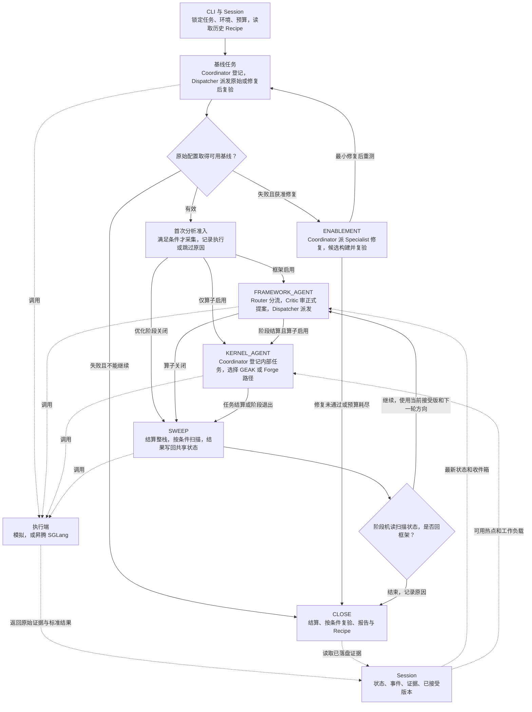
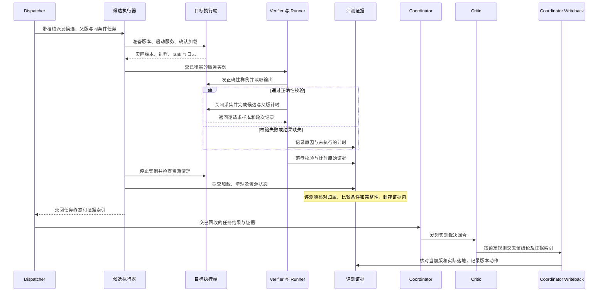

# Hyperloop 通用底稿初步规划

2026-11-24 · `base-v0.1` 设计稿 · Agent 行为对照版

**按本地 Hyperloom 1.1.5 独立复刻 Agent 的运行机制。** 保留 Coordinator 发起角色回合、意图分流、提案审查、资源调度、执行结算、反馈和下一轮重编排。把个人项目的设计重点放在**昇腾执行端复用、独立验证和证据可视化**。本地底稿用可重复的 Agent 响应与模拟执行端验证这些交接，910B3 和双 910B2 接同一套上层运行逻辑。

[查看可交互的 Agent 执行架构图](Agent执行架构图.html) · [查看执行端的交接](Agent执行架构图.html#execution) · [对照源码架构参考](源码架构参考.html#map) · [源码架构参考的两轮交接](源码架构参考.html#journey)

**证据口径。** 角色、阶段和触发条件以本地 `Hyperloom-main` 1.1.5 源码为准。源码课的总图、20 个部件卡和两轮案例用于组织阅读。快照没有 Git 提交元数据，本次结论来自静态追踪。以下 Hyperloop 实现与验收是规划。

## 1. 整体架构

下图先读阶段与跨阶段交接。第 2 节沿框架阶段跟踪角色消息，第 3 节展开算子、扫描与回环。设备执行和结果回写贯穿各阶段。



| 阶段或部件 | 要复刻的行为 | 上游依据 |
| --- | --- | --- |
| Coordinator、Phase Machine、Dispatcher | 每 tick 先核对遗留动作，再检查阶段。按条件发起 Agent 回合，回收完成任务并调度可运行工作，推进阶段和写回。任务有独立生命周期，可跨 tick。阶段退出要结算在途工作，按阶段规则处理队列 | [Coordinator](../../Hyperloom-main/src/hyperloom/orchestrator/loop/coordinator.py#L646) · [Dispatcher](../../Hyperloom-main/src/hyperloom/orchestrator/loop/dispatcher.py#L461) · [阶段规则](../../Hyperloom-main/docs/conceptual/optimization-loop.md#phase-order) |
| PRELUDE、ENABLEMENT、Profiler | 固定负载和原始启动方式，按结果决定是否进入受限修复。基线可用后，按预热、预算及采集能力决定是否排首次 Profile 或 Roofline。独立 Profile 先保存 trace，复合分析再解析热点 | [PRELUDE](../../Hyperloom-main/src/hyperloom/orchestrator/phases/prelude.py#L1632) · [ENABLEMENT](../../Hyperloom-main/docs/conceptual/optimization-loop.md#enablement) · [共享压测后端](../../Hyperloom-main/src/hyperloom/orchestrator/actions/executors/benchmark_backend.py#L34) |
| Orchestration、Critic、Specialist | 编排和审查由 Coordinator 发起回合，专项由任务派发。前者从状态和收件箱决定动作，后者用热点和调用证据交回调查、参数或补丁，统一经过意图和结果通道 | [回合上下文](../../Hyperloom-main/src/hyperloom/orchestrator/loop/conversation.py#L606) · [Specialist 派发](../../Hyperloom-main/src/hyperloom/orchestrator/specialists/dispatch.py#L165) · [Intent Router](../../Hyperloom-main/src/hyperloom/orchestrator/loop/intent_router.py#L461) |
| 框架、算子、SWEEP、CLOSE | 框架配置与源码专项单独跟踪。阶段入口调度算子任务，后端交回成果再复测。跨并发扫描按条件运行，回环与报告使用最后已接受的一整套配置 | [框架阶段](../../Hyperloom-main/src/hyperloom/orchestrator/phases/framework.py#L411) · [算子入口](../../Hyperloom-main/src/hyperloom/orchestrator/phases/kernel.py#L544) · [SWEEP](../../Hyperloom-main/src/hyperloom/orchestrator/phases/sweep.py#L73) · [CLOSE](../../Hyperloom-main/src/hyperloom/orchestrator/phases/close.py#L448) |

## 2. 框架阶段怎么交接

### 从提议到派发

**Coordinator → Orchestration。** Coordinator 把目标、当前接受版、热点、剩余预算、历史结果和收件箱交给 Orchestration。恢复后从落盘状态重新整理。Coordinator 也负责在有待审提案时发起 Critic 回合。[回合上下文](../../Hyperloom-main/src/hyperloom/orchestrator/loop/conversation.py#L606) · [Critic 回合](../../Hyperloom-main/src/hyperloom/orchestrator/roles/critic_agent.py#L420)

**Orchestration → Intent Router。** Orchestration 交调参、专项委派或阶段推进意图。Intent Router 先用 PolicyGate 检查角色、阶段和动作。合法的直接委派可登记到任务队列，正式提案进入待审。拒绝或补证理由写回提案方的收件箱。Dispatcher 在资源到位后启动已登记的任务。[正式提案](../../Hyperloom-main/src/hyperloom/orchestrator/loop/intent_router.py#L551) · [直接委派](../../Hyperloom-main/src/hyperloom/orchestrator/loop/intent_router.py#L937)

### A. 调参怎么测，成绩回给谁？

1. **Dispatcher → Explore。** 交要试的参数和工作点。Explore 把候选参数叠到当前配置上，跳过重复项，逐组交给 Benchmark Runner。
2. **Benchmark Runner → Explore。** 回每个候选的服务成绩、质量结果和日志。Explore 按规则给出该候选的 `KEEP` 或 `REVERT`。
3. **Explore → Dispatcher。** 整轮结束后，Explore 交每组参数的去留和待保留的配置。Dispatcher 回收任务并调用 Coordinator 的结果写回。[Explore 测量](../../Hyperloom-main/src/hyperloom/orchestrator/actions/executors/explore.py#L1258) · [整轮结果](../../Hyperloom-main/src/hyperloom/orchestrator/actions/executors/explore.py#L1628) · [Explore 写回](../../Hyperloom-main/src/hyperloom/orchestrator/loop/_explore_promotion.py#L48)

### B. Specialist 做完补丁，谁审、谁装、谁测？

1. **Specialist → Dispatcher → 框架阶段。** Specialist 交补丁、改动位置和自测证据。框架阶段核对交付，登记待审的集成提案。调查建议可以直接回给 Orchestration。上游 PR 按其已登记的审查与来源分流。
2. **Coordinator → Critic → Intent Router。** Coordinator 发起审查回合。Critic 看改动、试验依据、质量和回退办法，带提案 ID 回审查意见。Intent Router 据此登记获准的集成任务，或把退回原因交给提案方。
3. **Dispatcher → Integrate Patch → Benchmark Runner。** Dispatcher 启动集成任务。Integrate Patch 把补丁装到候选版本，按需构建并调用 Runner 测服务。Runner 把成绩交回集成执行器，由它按规则保留或撤销补丁，再把结算结果交 Dispatcher。[补丁提案登记](../../Hyperloom-main/src/hyperloom/orchestrator/phases/framework.py#L1823) · [审查结果处理](../../Hyperloom-main/src/hyperloom/orchestrator/loop/intent_router.py#L733) · [集成调用压测](../../Hyperloom-main/src/hyperloom/orchestrator/actions/executors/_integrate_bench.py#L267)

### 候选怎么成为当前版？

**Dispatcher → Coordinator Writeback → 共享状态。** Dispatcher 回收整个任务、广播结果，再调用 Coordinator 的写回程序。写回核对候选结果、实测证据和当前接受版本。候选的父版仍为当前版且达到验收要求时，KEEP 才能晋升。REVERT 留下成绩和原因。Orchestration 的下一回合从共享状态与收件箱读到结果。任务终态和候选裁决各自落盘，因此任务正常结束时仍能查清其中哪些候选被回退。[Dispatcher 回收](../../Hyperloom-main/src/hyperloom/orchestrator/loop/dispatcher.py#L1042) · [框架补丁写回](../../Hyperloom-main/src/hyperloom/orchestrator/loop/_integrate_promotion.py#L306)

## 3. 从框架退出，到算子、整栈复测和 SWEEP

### 什么时候进算子阶段？

Orchestration 可以建议转入算子阶段。Intent Router 把建议交给阶段机。阶段机结合调参与源码两条路线的进展、预算和有效建议判断何时退出框架，并等待在途任务结算。**算子开启时先进入算子阶段，退出后再进 SWEEP。算子关闭时，框架退出后直接到 SWEEP 入口。** 进算子阶段后由 Coordinator 登记内部任务，Dispatcher 取得资源后启动。任务按会话保存的选择运行，上游默认为 GEAK，显式选 Forge 时走 Forge。[阶段转换](../../Hyperloom-main/src/hyperloom/orchestrator/phases/machine_state.py#L1558) · [算子任务入口](../../Hyperloom-main/src/hyperloom/orchestrator/phases/kernel.py#L544)

- **GEAK。** 算子任务把当前接受版的启动配置、模型和负载交给 GEAK。GEAK 的工作流负责搜索配置和改写热点算子，交回候选配置或可加载的算子产物。Hyperloop 按同样的交接设计，用自己的服务评测复测可落地成果，再将合格结果写回当前版。[GEAK 工作流](../../Hyperloom-main/docs/components/geak.md#role-in-hyperloom) · [自身复测入口](../../Hyperloom-main/src/hyperloom/orchestrator/phases/kernel_geak_promotion.py#L146)
- **Forge。** 算子任务把当前版本、负载和可用热点交给改写控制器。控制器选算子并派发任务，Implementer Agent 写算子，Forge 程序做构建、数值校验和设备计时。控制器把补丁交给 Hyperloop 的算子集成器。集成器把补丁装到当前版本，请求服务复测，拿回成绩后决定提交或撤销。通过并落地的补丁交 Writeback。逐个候选的结算存档，摘要发给 Orchestration，整个算子任务的终态交 Dispatcher。[Forge 调度与集成入口](../../Hyperloom-main/src/hyperloom/orchestrator/phases/kernel.py#L763) · [服务复测](../../Hyperloom-main/src/hyperloom/orchestrator/kernel/request_handlers.py#L151)

底稿用模拟结果跑通两条算子路线的输入、回传和写回。已有热点可以供多轮编排使用。达到复采条件且采集可用时，Coordinator 再排 Profile，并保存对应版本、工作点和 rank。[复采依据](../../Hyperloom-main/src/hyperloom/orchestrator/loop/_validation_watermark.py#L94)

**同一个 Attention 热点，两条路线交付的东西不同。** 假设当前接受版的 trace 把一次 Attention 耗时关联到了具体调用点、输入形状和 rank。这个例子用于说明交接。

| 路线 | 谁改 Attention | 谁装回 SGLang、谁测整套服务 | 后端交回什么 |
| --- | --- | --- | --- |
| GEAK | GEAK 自己选优化方式。需要改源码时，由内部 kernel 工作流改写 Attention。 | GEAK 的 Integrator 把改动装回服务，GEAK 先测整套效果。接手方用自己的 Runner 独立复测可用方案。 | 整服务成绩，以及可用的启动配置或算子产物。工具成绩和独立复测各自留档。 |
| Forge | Rewrite Controller 选点，Implementer 写候选。Forge 构建、校验数值并测设备耗时。 | 接手方的算子集成器把补丁装到当前已接受的框架版本上，再请 Benchmark Runner 测整套 SGLang。 | 补丁、调用位置、构建、数值校验和设备计时记录。整套服务成绩由集成器另行回收。 |

每个 Session 会保存自己选择的算子路线。报告按候选注明工具内证据、父侧校验与服务复测分别发生在哪里。两条路线的交接可用源码参考逐步对照。[源码架构参考的 GEAK 与 Forge 交接](源码架构参考.html#flow-geak)

### 框架和算子都改了，谁测整栈？

**由 Benchmark Runner 测整套 SGLang 服务。** 算子集成器用已经接受的框架代码和启动参数加载候选算子，再调用 Runner。Runner 把整套服务的成绩交回集成器。若候选 KEEP，Writeback 把这次改动和实测写进当前版。双卡最终报告据此核对测到的服务是否同时加载了两层改动。[继承当前配置](../../Hyperloom-main/src/hyperloom/orchestrator/kernel/_integrate_payload.py#L134) · [启动完整服务复测](../../Hyperloom-main/src/hyperloom/orchestrator/kernel/_integrate_rebaseline.py#L267)

收尾时，如果当前组合还有未验证的 KEEP，而且基线、预算和资源允许，**CLOSE 请 Writeback 登记整栈复测，Dispatcher 启动 Explore，Explore 调同一个 Benchmark Runner**。结果沿同一路回写，以原始基线计算累计收益。已验证的组合可引用已有成绩。报告记录复测状态和跳过原因。[整栈复测任务](../../Hyperloom-main/src/hyperloom/orchestrator/loop/_resume_consistency.py#L108) · [收尾补测条件](../../Hyperloom-main/src/hyperloom/orchestrator/phases/close.py#L168) · [整栈走读](源码架构参考.html#flow-stack)

### SWEEP 的结果怎么决定下一步？

1. **SWEEP 入口 → Dispatcher。** 先结算待集成项和需要验证的组合，再看扫描开关、预算和上次扫描后是否有新验证收益。满足条件才登记扫描。跳过时由阶段入口写明状态和原因。
2. **扫描执行器 → Benchmark Runner。** 从 Session 取基线启动配置和当前接受的整套配置。先跑基线，再按基线已跑到的并发档重跑优化配置。用两边都完成的档位做对照。要比较原始框架源码与优化组合，评测端还要核对两边实际加载的源码和构建产物。
3. **扫描执行器 → Dispatcher → Writeback。** 扫描结束后交回成功、失败或跳过状态、配对结果和报告路径。Dispatcher 回收任务，Writeback 把扫描结论写入共享状态的 `last_conc_sweep`。
4. **阶段机读取状态 → 回框架或 CLOSE。** 阶段机用扫描终态、目标、预算和收敛情况决定去向。扫描失败进入 CLOSE。成功或按条件跳过后，符合继续条件就用当前接受版回框架，其余情况收尾并记录原因。[扫描入口](../../Hyperloom-main/src/hyperloom/orchestrator/phases/sweep.py#L80) · [两组逐档复测](../../Hyperloom-main/src/hyperloom/orchestrator/kernel/conc_sweep.py#L1139) · [扫描结果写回](../../Hyperloom-main/src/hyperloom/orchestrator/loop/_integrate_promotion.py#L398) · [下一阶段判定](../../Hyperloom-main/src/hyperloom/orchestrator/phases/machine_state.py#L1579)

## 4. 换卡、验证和看结果

### 4.1 换卡时改哪里？

**从单张 910B3 换到双 910B2，先换目标配置。** 现有执行端能处理的差异，通过配置切换。

| 底层模块 | 配置怎么改 | 什么情况下才改实现 |
| --- | --- | --- |
| 设备探测 | 指定预期的两张卡和设备编号，启用双卡通信检查 | 现有探测或 HCCL 检查无法覆盖目标环境时，补对应的检查 |
| SGLang 启停 | 填目标 Python 环境、设备和并行配置，以 `TP=2` 为例 | 目标版本的启动参数或启停方式超出现有支持时，适配命令 |
| 计时 | 选择目标环境已有的压测入口，沿用请求、计时规则和验收门槛 | 压测参数或输出格式超出现有支持时，改调用或解析 |
| Profile | 将采集目标从一个 rank 改为两个 rank | 采集工具、trace 格式或多 rank 回收方式超出现有支持时，改采集或解析 |
| 算子工具 | 选择目标 CANN 环境和构建参数 | 现有构建或设备计时工具无法在目标环境运行时，补对应实现 |

**上层 Agent 复用同一套提案、审查、派发和裁决流程。** 执行端接收同样格式的任务，交回同样格式的结果和原始证据。每种环境各建一份基线。双卡另外确认 HCCL 和两份 Profile，涉及算子候选时重新构建，并按实际分片后的输入校验。

把配置和实际运行信息分成三份记录。**任务规格**由评测方冻结，包含模型与 tokenizer、请求集、输入输出长度、并发、预热、重复、正确性和性能规则。**目标配置**说明希望使用哪些设备、TP、解释器和工具。**实际环境**由预检回传，记录真正可见的设备、rank 映射、驱动、CANN、Torch/NPU、SGLang 提交、采集器和构建能力。Coordinator 根据实际能力应用已有阶段政策。迁移后留住任务规格，换目标配置或对应执行模块，并在新环境建立基线。

底稿内部提供一组小接口。名字作为设计约定，模拟实现与真机实现遵循同一输入输出。

| 交互接口 | 谁交什么进去 | 下层交回什么 |
| --- | --- | --- |
| 目标预检 | CLI 交目标配置和必需能力。 | 实际环境、物理设备到逻辑 rank 的映射、HCCL 检查、可用或缺失的能力及原始探测记录。参数填了 `TP=2` 时，仍要证实服务确实建立两个 rank。 |
| 候选准备与服务控制 | Dispatcher 带资源租约和任务 ID 派发。Baseline 或候选动作交原版、父版或候选的版本凭据、允许的配置差异和工作区。 | 已准备的版本、实例凭据、实际启动命令、加载的提交与产物、就绪检查、日志。停止后还返回退出状态、清理结果和资源归还记录。 |
| 输出校验与请求计时 | Verifier 交锁定的样例、Reference 和容差。Runner 交工作点、重复轮次及计时约定。两者拿到已核实的实例凭据后才发送各自的请求。 | Verifier 接收逐例输出、形状与误差。Runner 接收逐请求事件、成功或失败状态、实际输入输出 token、首 token 时间、完成时间和轮次记录。评测方用这些原始数据计算汇总。 |
| 采集与解析 | Profile 动作交对应的版本、工作点、采集窗口和预期 rank。 | Profiler 交各 rank 原始 trace、工具版本和采集状态。Trace Analysis 另外交带 rank、调用点、形状和单位的热点索引。 |
| 算子构建与设备计时 | GEAK/Forge 路线交目标环境、候选源码、算子样例、适用形状及 Reference。 | 构建产物、日志、校验结果和设备计时样本。服务加载与端到端证据由服务控制和 Runner 另行生成。 |

所有返回都带任务与尝试 ID、运行状态和原始文件引用。适配器明确回报能力缺失、任务失败或部分完成。必需能力缺失时按任务政策停止或延后，可选能力被跳过时记录原因。上层根据这些状态决定下一步。环境命令、绝对路径和工具日志格式留在执行端。若目标 SGLang 的压测入口不同，由适配器负责调用和解析，并按同一计时口径产出记录。

### 4.2 拿什么判断这轮优化？

**上游已有版本核对、正确性、计时和决策证据的机制。** Hyperloop 将这些机制接到昇腾执行端，让 910B3 和双 910B2 使用同一套验收口径。

| 验证内容 | 原版 Hyperloom 已有 | 两套昇腾环境统一做法 |
| --- | --- | --- |
| 确认版本 | 记录补丁来源和实际服务启动信息。[启动证据](../../Hyperloom-main/src/hyperloom/orchestrator/actions/executors/_launch_evidence.py#L90) | 沿用启动核对，统一记录候选版本、实际加载配置。需要判断补丁效果时，补上改动路径确实执行的证据。 |
| 正确性 | KernelForge 有算子数值校验，服务侧按路径和配置启用准确率门。[算子校验](../../Hyperloom-main/docs/kernelforge/what-is-kernelforge.md#L26) · [服务准确率门](../../Hyperloom-main/src/hyperloom/orchestrator/actions/executors/explore.py#L1475) | 沿用正确性门。两端按预先锁定的参考和容差校验，候选通过后才进性能验收。 |
| 测速 | 已有单算子计时和服务端到端复测。[端到端复测](../../Hyperloom-main/src/hyperloom/orchestrator/phases/kernel_geak_promotion.py#L146) | 沿用独立复测。每种环境各建基线，在同一台机器关闭 Profile，用固定请求、重复策略和门槛比较候选与当前版本。 |
| 证据收集 | 已有 Session 汇总和决策轨迹。[结构化导出](../../Hyperloom-main/src/hyperloom/inference_optimizer/breakdown/exporter.py#L243) | 沿用落盘与报告机制。按候选用同一格式汇总启动记录、校验结果、原始计时、所需 Profile 和裁决。缺哪项证据就在报告里列明。 |

**三个对照各有用途。** 参考输出用来验对错，当前已接受版本用来判本轮收益，最初的基线用来算累计变化。

**每轮要有自己的比较凭据。** 父版和候选使用同一实际环境及设备拓扑、模型和 tokenizer、采样及请求、并发、预热、重复策略、计时边界与指标定义。允许的候选修改单独记录，实际变化须落在其范围内。默认用本轮同条件父版样本比较。若协议允许复用较早的父版样本，还须检查环境和工作点匹配、样本完整且满足锁定的新鲜度要求，并列出使用的批次。不同卡或不同 TP 的测量各自使用本环境基线。

| 证据状态 | 如何识别 | 怎样结算 |
| --- | --- | --- |
| 充分、可比 | 身份与工作点一致，应有的样本、校验与 rank 齐全，性能测量关闭采集。 | 计算收益和回归，按已锁定的门槛判断是否达标。 |
| 缺失或部分完成 | 少一次必需复测、少一个必需 rank、采集仍在导出，或证据文件未落盘。 | 标记无法判定，保留当前版，显示缺项与补测入口。 |
| 不可比或冲突 | 候选回退旧实现、token 提前结束、工作点变化、计时混入 Profile，或文件归属与实际版本冲突。 | 保留观察值和原因，排除出收益验收。若是正确性失败，则按对应的校验结果回退。 |

证据包按 ID 引用原始文件，记录生成部件、候选与父版、版本、环境、时间窗口和文件摘要。摘要用于校验完整性，独立的生成和写入边界用于确认来源。报告能将上游工具自报成绩、单算子数值、设备计时与本项目服务实测分别追到各自的原始证据。

### 4.3 Dispatcher 派发后，下层怎样执行？

下图从一次候选派发开始。上层发起和收回任务，执行模块返回可追溯的原始材料，评测方验证并汇总。



[打开执行端的交接视图](Agent执行架构图.html#execution)

#### 先锁住基线，再另开采集

1. **Baseline → 服务控制。** Baseline 带锁定的原始版本和同一份模型、请求、工作点启动 SGLang。服务控制完成设备与就绪核对，记录实际启动的提交、配置、进程及 rank。若原始配置启动失败，保存失败命令和日志。进入 ENABLEMENT 后，获准的最小修复另留版本记录，首次可运行且通过基线校验的版本作为有效基线。
2. **Verifier、Benchmark Runner → 原始样本。** 评测方先运行基线适用的输出校验，再按固定预热和重复策略执行独立计时。每组记录状态、请求计数、实际 token、TTFT、TPOT 和吞吐，以及计算这些指标使用的时间点、单位和有效样本。Runner 从负载确定发什么，评测方核对实际收到了什么。
3. **Baseline → Dispatcher → Writeback。** 回收任务时登记有效基线、环境指纹和证据位置。Coordinator 按阶段规则判断首次分析。条件满足时再排独立 Profile 任务。
4. **Profile → Profiler → Trace Analysis。** 采集任务复用指定版本、启动方式和负载，另开采集时段，并保存开始、停止和导出完成的记录。双卡按本次采集 ID 核对逻辑 rank、物理设备与版本，逐份登记。时钟来源和可校准状态随 trace 记录。时钟无法对齐的两份 trace 只做各 rank 的时间分析。热点可回溯到原始 trace 的事件和代码调用位置。

当采集触发于候选晋升或新一轮框架时，同一链路改用指定的新版本。报告分别保存采集任务和关闭 Profile 的计时任务。附录的上游调用顺序可以直接沿图对照。[基线与采集入口](源码架构参考.html#measurement-guide)

#### 候选按同一条评测链进入裁决

| 环节 | 框架参数 | 框架源码 | 热点算子 |
| --- | --- | --- | --- |
| 提案带入 | Explore 给出父版、启动参数变化与假设。 | Specialist 或已审上游交付给出父版、补丁、调用位置和自测。 | GEAK 或 Forge 返回候选配置、源码或构建产物，带热点、工作点、shape 和类型。 |
| 准备候选 | 复用父版源码，用候选配置创建独立实例。保存父版与候选的实际配置差异。 | 在候选工作区应用补丁并按需构建，记录提交、产物及加载依据。 | 按目标 CANN 与实际 rank 分片构建或加载。保存算子与当前框架版本的绑定，以及用于证明改动生效的受控 probe 或事件。 |
| 先校验 | 对模型输出、实际请求和 token 按锁定容差核对。 | 同样校验服务输出，同时核对改动确实被加载且满足提案适用条件。 | 先对实际 shape、dtype、边界用例做算子 Reference 校验，随后校验集成后的模型输出。 |
| 后计时 | 用同一工作点复测候选和已接受父版。 | 核对服务实测身份后执行同一端到端测试。 | 独立记录算子设备计时，最终用完整 SGLang 服务复测。整栈保留已接受的框架改动。 |

执行许可来自上层。候选进程只能写分配的工作区和产物目录，评测程序与请求、Reference、原始基线、阈值、裁决由评测方控制。加载失败、回退到旧实现或无法证明候选在目标工作点生效时，记录具体原因与已完成的步骤。正确性失败时直接结束候选的性能步骤。每次尝试单独编号，退出时核对服务、进程及设备资源已清理。

成对测量分别使用父版与候选的启动凭据。每个实例通过同一服务控制接口启动、核实加载、计时并清理。需要同卡交错复跑时，在任务规格内先固定执行顺序和服务隔离约定。

#### 将证据交回阶段机

Verifier、Runner、Profiler 先各自落原始证据。评测端按候选核对归属、完整性、有效范围和比较口径，封存证据包。Dispatcher 回收任务和租约，把执行状态及证据交 Coordinator。Coordinator 发起实测裁决，Critic 读取独立证据，按预先锁定的规则给出 KEEP、REVERT，或因缺证保留父版等待补测。Critic 将裁决及证据索引交 Writeback。Writeback 核对父版仍为当前版、产物实际落地，符合条件才晋升并写新版本。任务结果与候选裁决分别进入 Session，摘要交给 Orchestration 的收件箱。

失败可定位到 **预检、准备、服务就绪、校验、计时、采集导出、证据汇总、写回或清理**。已获准的暂时故障可在确认旧资源已释放后重试，新尝试沿用该轮锁定规格，并留前次失败记录。身份冲突、错误输出和政策拒绝按原因结算，由上层决定是否提交新的候选。进程归属或退出状态未确认时，Dispatcher 等待清理确认再发起同资源任务。

SWEEP 和整栈复测也走同一个 Runner。SWEEP 的父侧预备原始与已接受两份启动凭据，Runner 在每个并发点核对两边实际加载身份。已完成且可比的成对结果才能进入曲线。CLOSE 核对最后接受的整栈已有可信的服务复测，或按条件安排补测。允许跳过时记录理由及尚待验证范围。扫描和报告都引用同一份基线与版本记录。

### 4.4 报告上怎么看结论？

首屏把**证据是否足够、结果是否达标、最后保留哪个版本**放在一起。点开结论，可以看到这轮改了什么、怎么测的、用了哪条规则，以及对应的原始样本。

| 模拟案例 | 证据与结论 | 版本动作 |
| --- | --- | --- |
| 吞吐从 100 到 110 | 样本齐全，正确性、延迟和收益都过门槛 | KEEP，接受 110 |
| 吞吐从 110 到 112 | 样本齐全，收益 1.82%，低于示例门槛 2% | REVERT，保留 110 |
| 候选有样本，缺少当前版本的同条件复测 | 暂时无法判断本轮收益，报告指出缺哪组样本 | 保留当前版本，补测后再判 |

报告将**证据可信度、指标达标判断、版本动作**分别显示。用户可以从结果点进证据包，从证据包再到实际启动命令、输出校验、逐请求样本、rank trace 或失败记录。[打开交互示例](Agent执行架构图.html#validation)

一次任务可能包含多次验证。Session 报告按候选、父版、采集或复测分组，每条箭头写出谁发出请求、发了什么、谁接收并处理。回传结果另有一条箭头，可继续追到 Critic 的裁决。计时轮次、失败和跳过都在对应的验证里找。[查看一轮模拟补丁验证](../.runs/acceptance-base-v0.1-release/simulated/geak-tp2/report.html#validation-task-5-attempt-1) · [运行与复核](运行与复核.md)

## 5. Session 状态、证据和恢复

```text
sessions/<simulated 或 real>/<session-id>/
├── manifest.json          锁定任务和环境、原始版本、预算、政策
├── events.jsonl           阶段、Agent 回合、意图、准入、派发、反馈、裁决
├── state.json             当前阶段、收件箱游标、已接受版、最后应用的事件
├── baseline/<point>/      原始启动规格、逐请求数据、计时和质量证据
├── profile/<capture>/    按工作点和 rank 保存 trace、工具版本、热点与调用点
├── evidence/index.jsonl   按 ID 登记原始证据、生产方、摘要和归属
├── rounds/<round-id>/     提案、审查、工作区、运行、正确性、计时和裁决
│   └── evidence_bundle.json 本轮裁决所用证据、缺项、比较键和规则引用
├── sweep/                 逐档原版与当前版成对样本和跳过原因
├── summary.json           只读的时间线、验收、证据索引
├── report.md · report.html
└── recipes.jsonl          可复用经验、适用条件和失败线索
```

- 事件含顺序号、时间、角色、阶段、宏循环、`turn_id`、`proposal_id`、`task_id`、`candidate_id`、父版本和证据引用，按事件类型使用适用字段。可通过因果 ID 从一个任务同时定位请求、响应和产生的候选。
- 原始文件先落盘，随后登记证据并封存裁决使用的证据包。Coordinator 最后追加含证据包引用的完整裁决事件，再更新状态快照。中断前已提交的晋升可重放一次，未完成的轮次保留原因和产物，清理确认后从已接受版重新开始。恢复重建待审提案与角色收件箱。无法确认旧进程已经退出时，记录原因并等待清理确认。可视化和报告消费最后一条完整事件。[上游恢复回放](../../Hyperloom-main/src/hyperloom/orchestrator/loop/_resume_replay.py#L56) · [执行归属核对](../../Hyperloom-main/src/hyperloom/inference_optimizer/session/resume_guard.py#L200)
- 原始基线在一次 Session 内独立保留。首个可运行基线若依赖 Enablement，同时保留原始失败和最小修复说明。报告列出停止原因、证据路径和贡献来源，包括本人设计、手写、独立复测、Agent 生成与第三方复用。

## 6. 目录规划与底稿验收

```text
Hyperloop/
├── DOC/                      规划、架构图、源码参考和验收记录
├── pyproject.toml · README.md · .gitignore
├── configs/                  任务、模拟环境、阶段策略和角色配置
├── fixtures/                 请求、Reference、角色响应和执行证据
├── src/hyperloop/
│   ├── __main__.py           run / resume / status / report，装配接口
│   ├── contracts.py          角色回合、意图、任务、测量和事件
│   ├── coordinator.py        tick、状态写回和阶段驱动
│   ├── phases/               PRELUDE / ENABLEMENT / FRAMEWORK / KERNEL / SWEEP / CLOSE
│   ├── agents/               Orchestration、Critic、Specialist、上下文和 AgentBackend
│   ├── router.py             意图分流、待审提案与结果回传
│   ├── policy.py             阶段、角色、版本、路径和动作准入
│   ├── dispatcher.py         队列、租约、派发、回收
│   ├── actions/              Explore、Integrate Patch、Baseline、Profile、Trace Analysis
│   ├── kernel/               GEAK 式流水线及 Forge 式 handoff 和补丁结算
│   ├── evaluation/           独立 Verifier、Benchmark Runner、证据汇总和确定性裁决
│   ├── backends/             RuntimeBackend、模拟实现，后续加入昇腾实现
│   └── session.py · report.py 事件、快照、恢复、摘要和证据视图
└── tests/                    角色路由、任务状态、证据门、回环和恢复
```

先实现事件、状态、运行时和证据契约。其次实现真实的角色回合、Router、队列和各阶段，使预置响应经过完整的权限、调度和反馈。再接独立评测、报告重建和交互视图。以下行为都应在本地可重复观察后打 `base-v0.1`。接入 910B3 和双 910B2 的 Git 约定见 [Git 开发与双卡迁移约定](Git开发与双卡迁移约定.md)。

| 验收场景 | 必须能从产物证明的行为 |
| --- | --- |
| 原始基线启动失败 | 符合条件时自动派 Enablement Specialist，候选经构建和复测才能恢复。修复关闭或失败时保留原始证据并结束，CLOSE 仍产出报告 |
| 参数与源码两条路 | 合法 Explore 直委派可运行。正式提案按对应审查进入队列。Critic 在空审查包时跳过模型调用，被拒或待补充时反馈给收件箱。Specialist 回交源码、自测和来源，正式集成占用所需租约。阶段切换结算在途任务并留下队列处置记录 |
| 候选不同结果 | 正确且满足门槛则 KEEP，收益不足或指标回归则 REVERT，正确性不通过则无性能样本。Dispatcher 回收后，合格的 KEEP 经 Writeback 更新当前版，REVERT 保留原因 |
| 证据缺失、冲突和不可比 | 故意移除一组父版配对、换用错误版本的 trace、模拟服务回退旧实现及少发请求。报告逐项解释原因，保留实测数值和适用范围，缺证据的结论保持无法判定 |
| 算子后端替换 | 两种路径分别可重放。GEAK 成果复测和 Forge 补丁集成证据可区分。无候选、延期、未通过、任务完成各有落盘状态 |
| 下层交接与故障重试 | 用模拟初始化、校验、计时和采集任务走完相同的适配器接口。分别注入启动失败、校验失败、服务回退旧实现、采集少一个 rank 与未确认清理。图与报告能看到各故障发生在哪一步、后续哪些步骤会跳过或等待、是否启动了一个独立新尝试 |
| 复采与扫描 | 初采、达到水位复采、低于水位与已有任务占用可分别观察。SWEEP 回收后写入扫描状态。阶段机读入该状态，再按条件进入下一轮或 CLOSE，产物记录所用条件和原因 |
| 整栈复测 | 框架和算子均 KEEP 时，服务测量记录能证明加载了两层改动。模拟收尾待补测，核对 CLOSE 发起、Dispatcher 启动、Runner 测量和 Writeback 计算累计收益的交接 |
| 恢复 | 裁决前、裁决后快照前中断均可恢复。下一 Agent 回合看得到已提交裁决和待审提案，原始基线与证据包仍可核对 |
| 模块替换 | 两套模拟环境和适配器用同一个上层提交、同一任务摘要。只换目标配置和底层执行，核对同能力下的角色与阶段动作一致，并能显式呈现双 rank 或缺能力。910B3 和双 910B2 的真实性能、HCCL 与进程边界在目标机分别验收 |
| 可视化复查 | 从可信度、验收结果或版本动作进入同一证据包，再沿时间线找到当时的 Agent 输入、审批、任务和反馈。离线用原始样本和锁定规则复算相同结论 |
